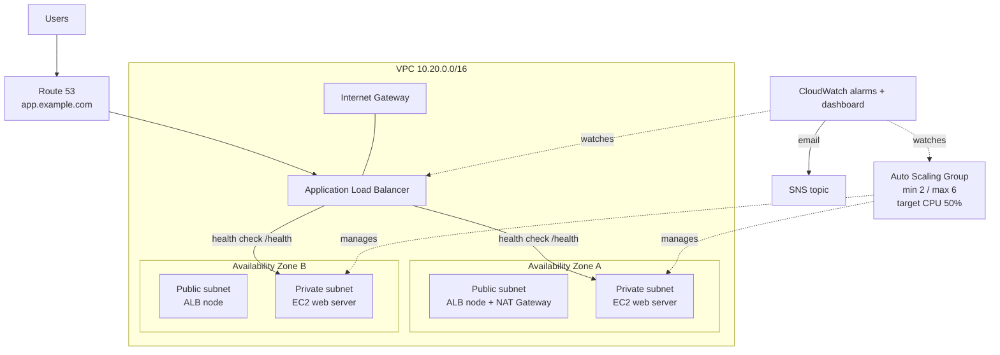

# Highly Available AWS Infrastructure with Auto Scaling

A fault-tolerant web tier on AWS, built entirely with **Terraform**. An **Application Load Balancer** spreads traffic across EC2 instances in **two Availability Zones**, an **Auto Scaling Group** adds or removes instances based on CPU and replaces unhealthy ones automatically, **CloudWatch** alarms send email alerts, and **Route 53** gives it a friendly domain name.

   

---
 
## Architecture



**What makes it highly available:**
- Instances run in **two AZs**. If a whole data centre fails, the other AZ keeps serving.
- The **ALB health check** stops traffic to a broken instance within about 45 seconds.
- The **ASG uses the ELB health check**, so a broken instance is terminated and replaced automatically.
- **Target tracking scaling** keeps average CPU near 50% by adding instances under load and removing them when it's quiet.

---

## Project structure

```
.
├── terraform/
│   ├── versions.tf          # Terraform + AWS provider
│   ├── variables.tf
│   ├── vpc.tf               # VPC, subnets, IGW, NAT, route tables (written by hand, no modules)
│   ├── security_groups.tf   # ALB SG (internet) -> App SG (ALB only)
│   ├── alb.tf               # Load balancer, target group, health check, listener
│   ├── asg.tf               # IAM role (SSM), launch template, ASG, scaling policy
│   ├── user_data.sh         # Boot script: installs Apache + demo page
│   ├── cloudwatch.tf        # SNS, alarms, dashboard
│   ├── route53.tf           # Optional domain record
│   └── outputs.tf
├── scripts/
│   ├── cpu-stress-test.sh   # Proves auto scaling
│   └── failover-test.sh     # Proves self-healing / high availability
└── docs/interview-guide.md
```

---

## How to run it

### Prerequisites
AWS account, AWS CLI v2 configured, Terraform ≥ 1.5.

### 1. Deploy
```bash
cd terraform
cp terraform.tfvars.example terraform.tfvars   # set alert_email (and domain_name if you have one)
terraform init
terraform plan
terraform apply
```
Confirm the SNS subscription email AWS sends you. Wait 2–3 minutes for the instances to pass health checks, then open the `alb_dns_name` output. **Refresh a few times**: the instance ID and AZ change, which shows the load balancing.

### 2. Test auto scaling
```bash
./scripts/cpu-stress-test.sh ha-web-asg ap-south-1
```
CPU goes to 100%, so the target tracking policy raises the desired capacity and new instances appear (about 3–5 minutes). After the 10-minute test ends, the ASG scales back in to 2.

### 3. Test self-healing
```bash
./scripts/failover-test.sh $(terraform -chdir=terraform output -raw alb_dns_name)
```
One instance is terminated, but the site keeps returning HTTP 200 and the ASG launches a replacement.

### 4. Clean up
```bash
cd terraform && terraform destroy
```
The NAT gateway and ALB are billed by the hour, so destroy when you're done.

---

## Key design decisions

| Decision | Reason |
|---|---|
| Instances in **private subnets** | Not reachable from the internet; only the ALB is public |
| **Security group chaining** (App SG allows only the ALB SG) | Nobody can bypass the load balancer |
| **SSM Session Manager** instead of SSH | No key pairs, no port 22 open, access is logged |
| **IMDSv2 required** | Protects instance metadata from SSRF attacks |
| AMI from **SSM parameter** | Always the latest patched Amazon Linux 2023, no hard-coded AMI IDs |
| **Target tracking** policy | Simpler and smoother than step scaling; AWS creates the alarms |
| **Instance refresh** | Changing the launch template rolls out new instances gradually |
| **Route 53 alias record** | Free queries and follows the ALB's changing IPs |
| Single NAT gateway | Lower cost for a demo; use one per AZ in production |

---

## Interview guide
See [docs/interview-guide.md](docs/interview-guide.md).
